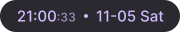
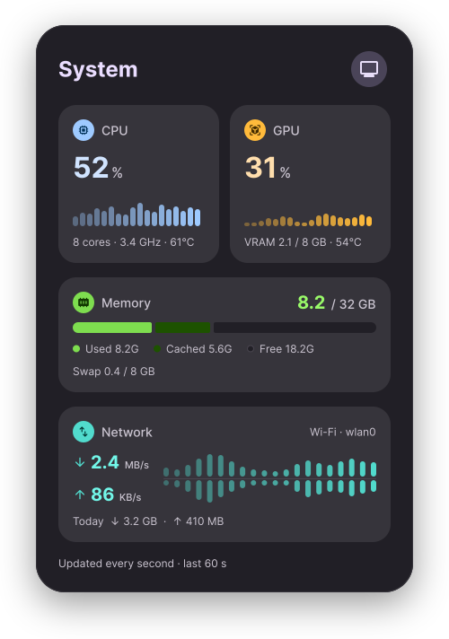
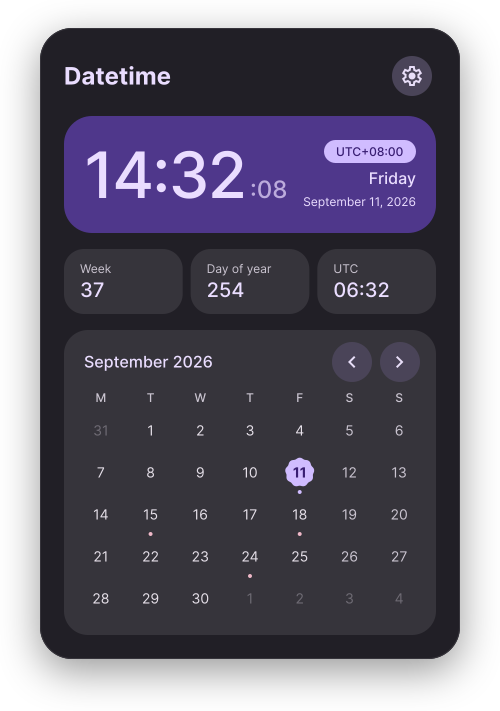
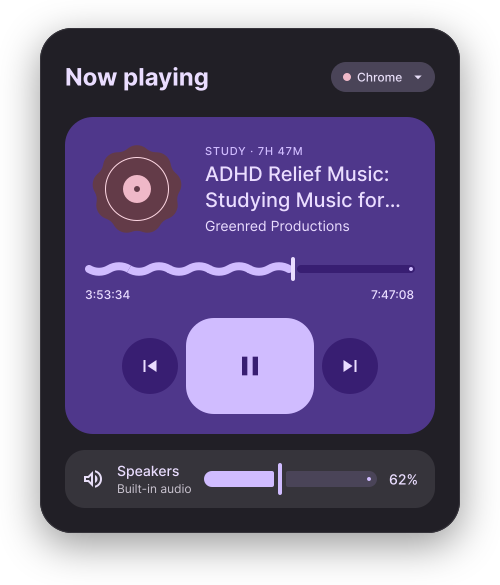
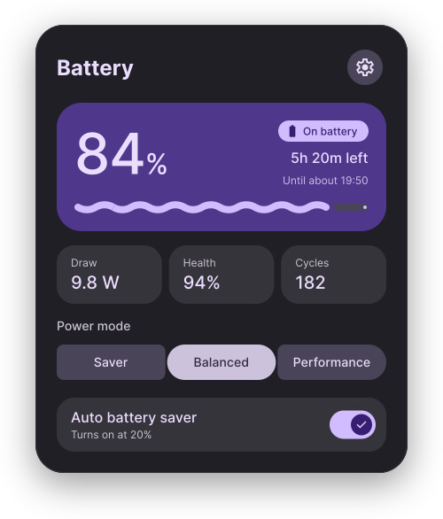
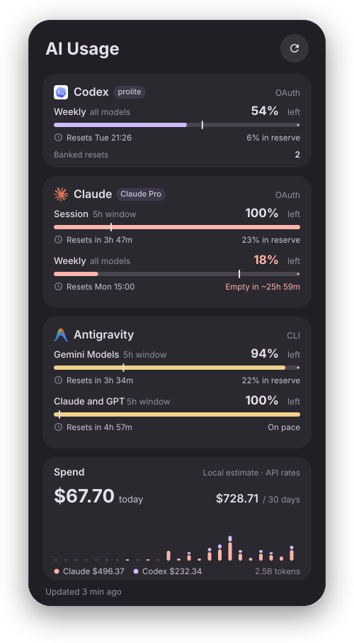
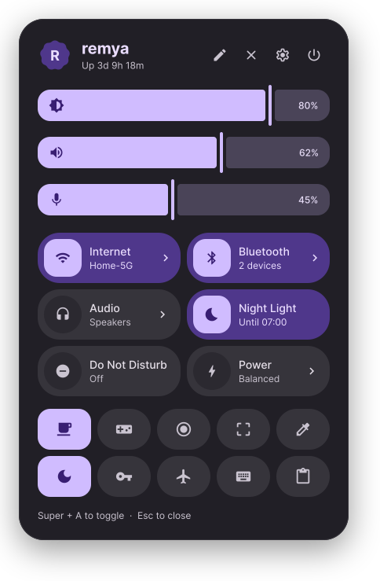
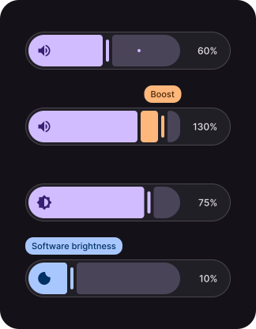

<p align="center">
  
</p>

<h1 align="center">Remy'a Bar</h1>

<h3 align="center">Многофункциональная панель состояния для Arch Linux Hyprland</h3>

<p align="center">
  
  
  
  
</p>

<p align="center">
  <a href="../README.md">English</a> ·
  <a href="README.zh-CN.md">简体中文</a> ·
  <a href="README.zh-TW.md">繁體中文</a> ·
  <strong>Русский</strong> ·
  <a href="README.de.md">Deutsch</a> ·
  <a href="README.es.md">Español</a> ·
  <a href="README.ja.md">日本語</a>
</p>

Современная плавная панель состояния для **Linux Hyprland**, созданная на **Flutter** и **Material Design 3 Expressive** и работающая на высокопроизводительном движке **Rust**. Визуально вдохновлена [illogical-impulse's Bar](https://github.com/end-4/dots-hyprland/tree/main/dots/.config/quickshell/ii/modules/ii/bar) и предлагает богатый набор виджетов состояния.

> [!WARNING]
> Это программное обеспечение находится в стадии **Beta** и может содержать ошибки или работать нестабильно. Функции и поведение продолжают дорабатываться, а оптимизация производительности всё ещё продолжается.

<p align="center">
  <video src="images/hero-demo.mp4" controls autoplay loop muted playsinline width="100%"></video>
</p>

## 🚀 Установка

`remya-bar` зависит от D-Bus-сервиса `top.remya.Core1`, предоставляемого **Remya Core** (`remya-core` / `remyad`), для управления общими токенами тем и сохранения конфигурации. Сначала установите и включите **Remya Core**, а затем установите **Remy'a Bar** (`top.remya.bar.service` автоматически настроен на запуск после `top.remya.core.service`; **Remya Settings** — необязательный графический интерфейс системных настроек).

### 1a. Установка через AUR (рекомендуется)

Установите `remya-bar` с помощью вашего любимого AUR-помощника:

```bash
paru -S remya-bar || yay -S remya-bar
```

### 1b. Установка из релизного архива (Linux x86_64)

После загрузки релизного архива Linux x86_64 со страницы [Releases](https://github.com/remyhuang03/remya-bar/releases) вы можете установить его с помощью встроенного скрипта `tool/install.py`:

```bash
# Проверка контрольной суммы
sha256sum -c SHA256SUMS --ignore-missing

# Распаковка и установка
tar --zstd -xf remya_bar-<version>-linux-x86_64.tar.zst
cd remya_bar-<version>-linux-x86_64
python tool/install.py
```

Установщик копирует файлы в `~/.local/bin` и `XDG_DATA_HOME`, создаёт и включает пользовательский юнит systemd `top.remya.bar.service` и настраивает запуск панели вместе с `graphical-session.target` (требуются переменные `WAYLAND_DISPLAY` и `HYPRLAND_INSTANCE_SIGNATURE` в окружении пользовательского менеджера, например предоставляемые `uwsm`). При повторной установке юнит автоматически останавливается, пакет обновляется, а сервис перезапускается. Выполните `systemctl --user disable --now top.remya.bar.service`, чтобы отключить автозапуск.

### 2. Настройка Hyprland

Добавьте следующие комбинации клавиш в конфигурацию Hyprland на Lua (например, `~/.config/hypr/hyprland.lua`) (если привязки уже существовали ранее, их можно предварительно снять с помощью `hl.unbind(...)`):

```lua
local barShortcutSignal = 'gdbus emit --session --object-path /top/remya/bar --signal top.remya.bar.Shortcuts.'

-- Переключение боковой панели быстрых настроек
hl.bind(
    "SUPER + A",
    hl.dsp.exec_cmd(barShortcutSignal .. 'ToggleSidebar "$HYPRLAND_INSTANCE_SIGNATURE"')
)

-- Горячие клавиши громкости и яркости
hl.bind(
    "XF86AudioRaiseVolume",
    hl.dsp.exec_cmd(barShortcutSignal .. 'VolumeUp "$HYPRLAND_INSTANCE_SIGNATURE"'),
    { locked = true, repeating = true }
)
hl.bind(
    "XF86AudioLowerVolume",
    hl.dsp.exec_cmd(barShortcutSignal .. 'VolumeDown "$HYPRLAND_INSTANCE_SIGNATURE"'),
    { locked = true, repeating = true }
)
hl.bind(
    "XF86AudioMute",
    hl.dsp.exec_cmd(barShortcutSignal .. 'VolumeMute "$HYPRLAND_INSTANCE_SIGNATURE"'),
    { locked = true }
)
hl.bind(
    "XF86MonBrightnessUp",
    hl.dsp.exec_cmd(barShortcutSignal .. 'BrightnessUp "$HYPRLAND_INSTANCE_SIGNATURE"'),
    { locked = true, repeating = true }
)
hl.bind(
    "XF86MonBrightnessDown",
    hl.dsp.exec_cmd(barShortcutSignal .. 'BrightnessDown "$HYPRLAND_INSTANCE_SIGNATURE"'),
    { locked = true, repeating = true }
)
```

## ✨ Возможности

### Капсулы панели состояния

<table>
  <tr>
    <th>Капсула</th>
    <th>Описание</th>
  </tr>
  <tr>
    <td align="center"></td>
    <td><strong>Быстрый доступ</strong>: объединяет статусы сети, Bluetooth, громкости и др.; нажатие открывает центр управления.</td>
  </tr>
  <tr>
    <td align="center"></td>
    <td><strong>Медиаплеер</strong>: отображает текущий трек, поддерживает паузу/воспроизведение и переключение треков в один клик.</td>
  </tr>
  <tr>
    <td align="center"></td>
    <td><strong>Часы и дата</strong>: точно отображает текущее время и дату; нажатие или наведение раскрывает календарь.</td>
  </tr>
  <tr>
    <td align="center"></td>
    <td><strong>Рабочие пространства</strong>: показывает значки приложений, активное окно и срочные уведомления на рабочих столах.</td>
  </tr>
  <tr>
    <td align="center"></td>
    <td><strong>Системные ресурсы</strong>: отображает загрузку CPU, памяти и других ресурсов в реальном времени.</td>
  </tr>
  <tr>
    <td align="center"></td>
    <td><strong>Использование ИИ</strong>: наглядно показывает оставшийся лимит и время сброса для подписок ИИ.</td>
  </tr>
</table>

### Всплывающие панели и центр управления

<table>
  <tr>
    <td width="50%" align="center" valign="top">
      
    </td>
    <td width="50%" align="center" valign="top">
      
    </td>
  </tr>
  <tr>
    <td align="center"><sub><b>Мониторинг системы</b>: CPU, GPU, распределение памяти и 60-секундные графики сети</sub></td>
    <td align="center"><sub><b>Дата и время</b>: крупные часы, мировое время, номер недели и интерактивный календарь</sub></td>
  </tr>
  <tr>
    <td width="50%" align="center" valign="top">
      
    </td>
    <td width="50%" align="center" valign="top">
      
    </td>
  </tr>
  <tr>
    <td align="center"><sub><b>Управление медиа</b>: адаптивные цвета по обложке альбома, перемотка и громкость</sub></td>
    <td align="center"><sub><b>Батарея и питание</b>: заряд, энергопотребление, износ, циклы и переключение режимов питания</sub></td>
  </tr>
  <tr>
    <td width="50%" align="center" valign="top">
      
    </td>
    <td width="50%" align="center" valign="top">
      
    </td>
  </tr>
  <tr>
    <td align="center"><sub><b>Использование ИИ</b>: сессионные и недельные квоты разных платформ, таймеры сброса и дневная статистика</sub></td>
    <td align="center"><sub><b>Быстрые настройки</b>: системные переключатели и ярлыки полезных инструментов</sub></td>
  </tr>
</table>

### Экранные индикаторы (OSD)

<table>
  <tr>
    <td width="45%" align="center">
      
    </td>
    <td>
      <ul>
        <li><strong>Громкость и усиление</strong>: при изменении громкости или включении усиления сверху по центру появляется капсула с текущим уровнем.</li>
        <li><strong>Яркость и программное затемнение</strong>: поддержка индикации аппаратной подсветки и программной яркости с чётким разделением режимов.</li>
        <li><strong>Уведомления и «Не беспокоить»</strong>: сбор пропущенных уведомлений с очисткой в один клик и переключателем режима «Не беспокоить».</li>
      </ul>
    </td>
  </tr>
</table>

## ⌨️ Разработка

### Стек технологий и архитектура

- **Flutter**: версия `3.47.9`, закреплённая через FVM, с Material Design 3 Expressive (`material_ui`).
- **Rust**: редакция `2024`, управляется как Cargo workspace с помощью корневого `rust-toolchain.toml`.
- **FFI**: `flutter_rust_bridge` связывает `remya_bar_hyprland` и `remya_bar_system` с Flutter.
- **Wayland**: нативный GTK-раннер с динамической линковкой `gtk-layer-shell` для окон панели на каждом мониторе, плавающего хоста `BarPopup` и отдельного окна `--settings`.
- **Интеграция с Core**: подключение через сеансовый D-Bus (`top.remya.Core1`) к пакетам `remya_client` и `remya_ui` из `remya-core` для общих тем и атомарного сохранения настроек. Подробности контракта см. в [docs/backend.md](backend.md).

```
┌────────────────────────────────────────────────────────┐
│                   Flutter UI Layer                     │
│  - MD3 Expressive widgets & spring animations          │
│  - Per-monitor GTK Layer-Shell views                   │
│  - Floating popup host (BarPopup) & --settings window  │
└───────────────────────────▲────────────────────────────┘
                            │ flutter_rust_bridge
┌───────────────────────────▼────────────────────────────┐
│                    Rust Workspace                      │
│  - remya_bar_hyprland: Tokio Unix socket IPC & events  │
│  - remya_bar_system: Cached /proc, sysfs, GPU & MPRIS  │
│  - System tray SNI host & DBusMenu client              │
└───────────────────────────▲────────────────────────────┘
                            │ D-Bus (top.remya.Core1)
┌───────────────────────────▼────────────────────────────┐
│                   Remya Core (remyad)                  │
│  - Shared theme tokens, system settings & preferences  │
└────────────────────────────────────────────────────────┘
```

- **Структура каталогов**:
  - `lib/main.dart` и `lib/app.dart`: запуск приложения и сборка корневого виджета.
  - `lib/features/`: разделённые по функциям UI, состояния и контроллеры Flutter.
  - `lib/src/rust/`: модульные крейты Rust (`hyprland`, `system`, `core` и сгенерированные bridge-крейты).
  - `linux/`: нативный GTK-раннер, конфигурация `gtk-layer-shell` и скрипты упаковки.
  - `assets/icons/`: значок приложения и функциональные иконки.
  - `tool/install.py`: скрипт установки XDG и настройки пользовательского сервиса systemd.

### Требования и подготовка окружения

- FVM с установленным Flutter SDK `3.47.9`
- Инструментарий Rust (`2024` edition), управляемый через `rustup`
- Для разработки требуется соседний каталог `../remya-core` с исходным кодом, предоставляющий `packages/remya_client` и `packages/remya_ui` (собранным релизным пакетам он не нужен)
- Во время выполнения требуется установленный и включённый **Remya Core** (предоставляющий `dbus-1/services/top.remya.Core1.service` и `top.remya.core.service`)
- Зависимости времени выполнения и нативной сборки для Arch Linux:

| Зависимость | Назначение |
| :--- | :--- |
| `gtk-layer-shell`, `wayland`, `libxkbcommon`, `wayland-protocols` | Поверхности Wayland layer-shell, обработка ввода и `wayland-scanner` |
| `sqlite` | Хранение истории уведомлений |
| `inter-font`, `noto-fonts-cjk` | Системная типографика и запасные шрифты CJK |
| `networkmanager`, `bluez` | Переключатели сети и Bluetooth в быстрых настройках |
| `nvidia-utils` *(необязательно)* | Библиотека `libnvidia-ml.so.1` для метрик NVIDIA GPU |
| `codexbar-cli` *(необязательно)* | Исполняемый файл `codexbar` для получения квот ИИ |

```bash
fvm install
fvm flutter pub get
```

После изменения API моста Rust перегенерируйте привязки с помощью `flutter_rust_bridge_codegen` и `flutter_rust_bridge.yaml`.

### Проверка и локальная установка

```bash
# Форматирование, статический анализ и тесты Dart
fvm dart format --output=none --set-exit-if-changed lib test
fvm flutter analyze
fvm flutter test

# Форматирование, линтеры и тесты Rust
cargo fmt --all -- --check
cargo clippy --workspace --all-targets -- -D warnings
cargo test --workspace

# Отладочная сборка для Linux и нативные lifecycle / smoke-тесты
fvm flutter build linux --debug
cmake --build build/linux/x64/debug --target bar_lifecycle_test
build/linux/x64/debug/bundle/bar_lifecycle_test
python test/bar_window_smoke.py  # Требуется запущенная сессия Hyprland

# Релизная сборка и установка в локальные каталоги XDG
fvm flutter build linux --release
python tool/install.py
```

## 📜 Лицензия

Проект распространяется под лицензией [PolyForm Noncommercial License 1.0.0](../LICENSE).